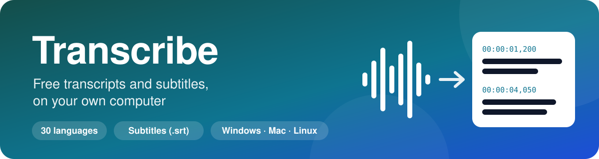
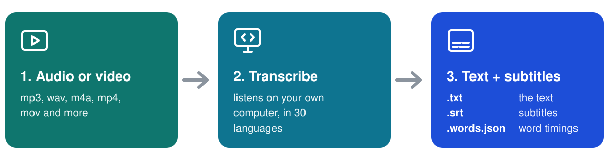

<p align="center">
  
</p>

Turn **audio and video into text and subtitles** on your own computer, for free. No account, no subscription, no upload limits, and your recordings never leave your computer.

Transcribe is a beginner-friendly kit for **[Qwen3-ASR](https://github.com/QwenLM/Qwen3-ASR)**, the free, open speech-recognition models from the Qwen team. It installs everything into one folder, and you use it in your browser, with one short command, or through your AI assistant.

<p align="center">
  
</p>

> Transcribe is an unofficial kit made by Clipizo. It is not affiliated with or endorsed by Alibaba Cloud or the Qwen team.
> The official Qwen3-ASR source code is on GitHub: **[QwenLM/Qwen3-ASR](https://github.com/QwenLM/Qwen3-ASR)**.
> Want AI voiceovers? See the companion kit **[AIvoice](https://github.com/Clipizo/AIvoice)**.

## What you need

- **Free disk space: about 15 GB.** The programs take about 8 GB (less without an NVIDIA graphics card). The AI models take about 4 to 7 GB and download by themselves the first time you use Transcribe (see [The AI models](#the-ai-models)).
- **A computer:** a Windows 10 or 11 PC, a Mac with Apple Silicon (M1 or newer), or a Linux PC. Intel Macs and Windows on ARM aren't supported.
- **A graphics card (optional):** with an NVIDIA graphics card (6 GB or more; 8 GB or more for best quality) or on a Mac it's quick. Without either, it runs on the processor: it works, but long recordings take a while.
- **An internet connection** for the install (3 to 4 GB with an NVIDIA card, less without) and the first download of the models.

## Installation

### The easiest way: let your AI assistant guide you

Paste this into ChatGPT, Claude, Gemini or Copilot:

```text
Help me install and use Transcribe: https://github.com/Clipizo/Transcribe
Read its file "Transcribe AI Guide.md" first, then guide me one step at a time.
```

If your AI can't open links, download [`Transcribe AI Guide.md`](Transcribe%20AI%20Guide.md) and attach it to the chat instead.

Using an AI agent that can run commands (Claude Code, OpenAI Codex, Gemini CLI, Cursor, VS Code with Copilot)? Ask it, for example, *"Download https://github.com/Clipizo/Transcribe to C:\Transcribe, install it by following its SKILL.md, then make subtitles for my-video.mp4"* (on a Mac or Linux, say `~/Transcribe`). If you already have the Transcribe folder, open it in the agent instead. The agent follows `AGENTS.md` and `SKILL.md`.

### Install it yourself

You don't need Python or anything else first: the installer gets everything Transcribe needs and puts it in the Transcribe folder. It takes 5 to 30 minutes, depending on your internet connection.

**How it works:** copy a command, paste it into the window, and press Enter. Wait until the window is ready for the next one (Windows: a new line starting with `PS`; Mac and Linux: a new line ending with `%` or `$`). Many commands print nothing when they work, and that's normal.

#### Windows 10 or 11

**Step 1. Open PowerShell.** Press the Windows key, type `PowerShell`, and press Enter. To paste in it, right-click or press Ctrl+V.

**Step 2. Download Transcribe**
```powershell
Invoke-WebRequest "https://github.com/Clipizo/Transcribe/archive/refs/heads/main.zip" -OutFile "$env:TEMP\Transcribe.zip" -UseBasicParsing
```

**Step 3. Unzip it**
```powershell
Expand-Archive "$env:TEMP\Transcribe.zip" -DestinationPath "C:\" -Force
```

**Step 4. Rename the folder to `C:\Transcribe`**
```powershell
Rename-Item "C:\Transcribe-main" "Transcribe"
```

**Step 5. Go into the folder**
```powershell
cd C:\Transcribe
```

**Step 6. Install Transcribe**
```powershell
./install-windows.bat
```
It works through 4 steps. Downloading PyTorch (about 3 GB with an NVIDIA graphics card) can take a while and may look stuck, but it isn't. Don't click inside the window, because that pauses it (if the window's title starts with *Select*, press Esc). When it asks *"Download the AI models now?"*, press Enter (another 4 to 7 GB, so this can also take a while). It's done when it says **Transcribe is installed!**, then *"Press any key to continue"*: press a key.

**Step 7. Start Transcribe**
```powershell
./transcribe
```
Transcribe opens in your browser. Drop in a video or audio file and click **Transcribe**. Keep the PowerShell window open while you use it.

**If a step shows red text:**
- **Step 2:** check your internet connection and paste the command again.
- **Step 4** says the file *already exists*: you already have a `C:\Transcribe` folder. Keep it under another name with the command below, then do step 4 again.
  ```powershell
  Rename-Item "C:\Transcribe" "Transcribe-old"
  ```
- **Step 6:** the installer explains the problem in plain words. Paste the command again: it continues where it stopped. Still stuck? Give the text in the window, or the file `install-log.txt` in `C:\Transcribe`, to your AI assistant.

Prefer clicking? Click the green **Code** button on this page > **Download ZIP**. Right-click the ZIP > **Extract All...**, extract it to `C:\` and rename the folder to `C:\Transcribe`. Then double-click `install-windows.bat` to install, and `transcribe.bat` to start. If Windows says *"Windows protected your PC"*, click **More info** > **Run anyway**.

#### Mac (Apple Silicon)

**Step 1. Open Terminal.** Press Cmd+Space, type `Terminal`, and press Enter.

**Step 2. Go to your home folder**
```bash
cd ~
```

**Step 3. Download Transcribe**
```bash
curl -L -o Transcribe.tar.gz https://github.com/Clipizo/Transcribe/archive/refs/heads/main.tar.gz
```

**Step 4. Unpack it**
```bash
tar -xzf Transcribe.tar.gz
```

**Step 5. Rename the folder to `Transcribe`**
```bash
mv Transcribe-main Transcribe
```

**Step 6. Go into the folder**
```bash
cd ~/Transcribe
```

**Step 7. Install Transcribe** (it works through 4 steps; when it asks *"Download the AI models now?"*, press Enter; it's done when it says **Transcribe is installed!**)
```bash
bash install.sh
```

**Step 8. Start Transcribe**
```bash
./transcribe
```
Transcribe opens in your browser. Keep the Terminal window open while you use it.

Installed Transcribe before? Then before step 5, keep the old folder under another name with `mv ~/Transcribe ~/Transcribe-old`.

#### Linux

The same steps as on a Mac, in a terminal (on Ubuntu, press Ctrl+Alt+T to open one). If step 3 says `curl: command not found`, use this instead:
```bash
wget -O Transcribe.tar.gz https://github.com/Clipizo/Transcribe/archive/refs/heads/main.tar.gz
```
You don't need administrator rights (`sudo`) for any step. For an NVIDIA graphics card, the NVIDIA driver must be installed (the command `nvidia-smi` should work).

**To start it again later:**

- **Windows:** double-click `transcribe.bat` in the `C:\Transcribe` folder.
- **Mac and Linux:** in Terminal, run `cd ~/Transcribe` and then `./transcribe`.

## The AI models

Transcribe uses the official **Qwen3-ASR** models from the Qwen team. Their source code, technical report and benchmarks are at [github.com/QwenLM/Qwen3-ASR](https://github.com/QwenLM/Qwen3-ASR). **You don't need to download them yourself:** Transcribe downloads them from [Hugging Face](https://huggingface.co/Qwen) the first time you use it, and keeps them in the `models` folder. Each model downloads only once, and an interrupted download continues where it stopped.

| Model | What it's for | Size | Download page |
|---|---|---|---|
| `Qwen3-ASR-1.7B` | Speech to text, best quality | about 4.7 GB | [Hugging Face](https://huggingface.co/Qwen/Qwen3-ASR-1.7B) · [ModelScope](https://modelscope.cn/models/Qwen/Qwen3-ASR-1.7B) |
| `Qwen3-ASR-0.6B` | Speech to text, fast | about 1.9 GB | [Hugging Face](https://huggingface.co/Qwen/Qwen3-ASR-0.6B) · [ModelScope](https://modelscope.cn/models/Qwen/Qwen3-ASR-0.6B) |
| `Qwen3-ForcedAligner-0.6B` | Word timings for subtitles | about 1.9 GB | [Hugging Face](https://huggingface.co/Qwen/Qwen3-ForcedAligner-0.6B) · [ModelScope](https://modelscope.cn/models/Qwen/Qwen3-ForcedAligner-0.6B) |

You need one of the two speech-to-text models, fast (0.6B) or best quality (1.7B), which the installer picks for your computer, plus the timing model for subtitles.

**To download them in advance,** for example before you go offline:

- answer yes when the installer asks *"Download the AI models now?"*;
- or run `./transcribe download`.

**If your network blocks Hugging Face,** download every file from the model's page above (or from ModelScope, which is easier to reach in mainland China) into `models/<model name>/` in the Transcribe folder, keeping its subfolders. Then create an empty file named `.download-complete` in that folder. Section 9 of the [AI guide](Transcribe%20AI%20Guide.md) explains it step by step.

## Using Transcribe

Start Transcribe (double-click `transcribe.bat` on Windows, or run `./transcribe` in the Transcribe folder) and it opens in your browser:

1. Drop in an audio or video file. If you like, add names and terms it should know, the language, or your script.
2. Click **Transcribe**.
3. Shape the subtitles: characters per line, words per line (1 = one word at a time), 1 or 2 lines, UPPERCASE, no punctuation. The preview shows them on your video right away, without transcribing again.
4. Download the subtitles (`.srt`), the text (`.txt`) and the word timings (`.words.json`). They're also in the **`output`** folder.

It runs only on your computer. Keep the window that started it open while you use it; close it to stop Transcribe.

### Or use commands

You can also type a command. Open PowerShell (Windows) or Terminal (Mac and Linux), go into the Transcribe folder as in the install steps, and type one of these. The commands are the same on every system.

| What | Command |
|---|---|
| Text and subtitles of a video | `./transcribe my-video.mp4` |
| Text only (faster) | `./transcribe interview.mp3 --no-subtitles` |
| Help with names and terms | `./transcribe podcast.mp3 --hint "Clipizo, DaVinci Resolve"` |
| Force the language | `./transcribe lecture.m4a --language Spanish` |
| Subtitles with your script's exact words | `./transcribe voiceover.wav --script my-script.txt` |
| Short lines for vertical videos | `./transcribe short.mp4 --max-chars 20` |
| One word at a time, in capitals | `./transcribe short.mp4 --max-words 1 --caps --no-punctuation` |
| Two lines per subtitle | `./transcribe film.mp4 --lines 2` |
| Several files | `./transcribe part1.mp4 part2.mp4 part3.mp4` |
| A file name with spaces (use quote marks) | `./transcribe "my holiday video.mp4"` |
| Open it in the browser | `./transcribe` |
| A simple menu in the terminal | `./transcribe menu` |
| Check the setup | `./transcribe check` |

`./transcribe help` lists every option.

## What you get

For `my-video.mp4`, the `output` folder gets:

| File | Contents |
|---|---|
| `my-video.txt` | The text, one sentence per line. |
| `my-video.srt` | Subtitles. Import them into your video editor like a media file, or upload them to YouTube. |
| `my-video.words.json` | Every word with its start and end time, for animated captions and other tools. |

- **Languages for text:** Chinese, English, Cantonese, Arabic, German, French, Spanish, Portuguese, Indonesian, Italian, Korean, Russian, Thai, Vietnamese, Japanese, Turkish, Hindi, Malay, Dutch, Swedish, Danish, Finnish, Polish, Czech, Filipino, Persian, Greek, Romanian, Hungarian, Macedonian, and 22 Chinese dialects.
- **Languages for subtitle timings:** English, Chinese, Cantonese, French, German, Italian, Japanese, Korean, Portuguese, Russian and Spanish. Other languages get the text only.
- **Files:** almost any audio or video: mp3, wav, m4a, aac, flac, ogg, mp4, mov, mkv, webm...
- **Long recordings** are processed in parts of about 3 minutes; an hour-long recording is fine.

Transcribe picks the best settings for your computer automatically. `--quality fast` (the smaller 0.6B model) or `--quality best` (the 1.7B model) overrides them.

## What is inside

| File or folder | Contents |
|---|---|
| `install-windows.bat`, `install.sh` | The installers. Run them again at any time to repair the install. |
| `transcribe.bat`, `transcribe.sh` | Start Transcribe (the browser app, or commands). On Mac and Linux the installer also adds a `transcribe` shortcut, so `./transcribe` works everywhere. |
| `Transcribe AI Guide.md` | Everything an AI assistant needs to help you, step by step, including troubleshooting. |
| `AGENTS.md`, `SKILL.md` | Instructions for AI agents. `CLAUDE.md` and `GEMINI.md` point to them. |
| `app/` | The Transcribe program. |
| `assets/` | The pictures on this page. |
| `output/` | Your transcripts and subtitles. |
| `envs/`, `models/`, `.tools/` | Created by the installer: Python, the AI libraries and the downloaded models. |

**To uninstall,** delete the Transcribe folder. Nothing else is installed on your computer, except Microsoft's free Visual C++ component on a Windows PC that didn't have it yet (the installer asks first; other programs use it too, so leave it).

## Respect people's privacy

Transcribe recordings you made, or have the right to use. Recording or transcribing people without their consent can be illegal in some places.

## License and credits

Transcribe is free of charge, under the Clipizo product license in `LICENSE.txt`. Use it and what you make with it in your own projects, personal or commercial, including client work and monetized videos. Please don't re-upload or redistribute the kit's files; link to this page instead.

The AI models are made by the Qwen team at Alibaba Cloud and released under the Apache 2.0 license: [Qwen3-ASR](https://github.com/QwenLM/Qwen3-ASR). The installer downloads them, and the other open-source tools Transcribe uses, from their official sources. See `THIRD-PARTY-NOTICES.md`.
