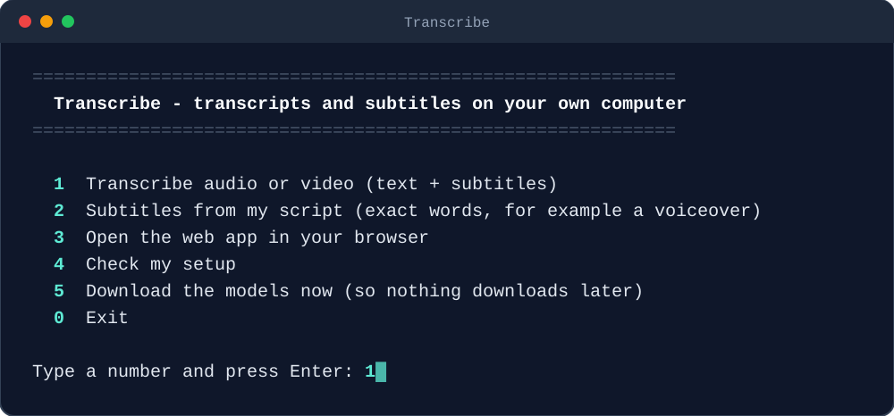

<p align="center">
  
</p>

Turn **audio and video into text and subtitles** on your own computer, for free. No account, no subscription, no upload limits, and your recordings never leave your computer.

Transcribe is a beginner-friendly kit for **Qwen3-ASR**, the free, open speech-recognition models from the Qwen team. It installs everything into one folder, and you use it from a simple menu, with one short command, or through your AI assistant.

<p align="center">
  
</p>

> Transcribe is an unofficial kit made by Clipizo. It is not affiliated with or endorsed by Alibaba Cloud or the Qwen team.
> Want AI voiceovers? See the companion kit **[AIvoice](https://github.com/Clipizo/AIvoice)**.

## What you need

- **Free disk space: about 15 GB.** The programs take about 7 GB (less without an NVIDIA graphics card). The AI models take about 4 to 7 GB and download the first time you use Transcribe.
- **A computer:** a Windows 10 or 11 PC, a Mac with Apple Silicon (M1 or newer), or a Linux PC. Intel Macs and Windows on ARM aren't supported.
- **A graphics card (optional):** with an NVIDIA graphics card (6 GB or more; 8 GB or more for best quality) or on a Mac it's quick. Without either, it runs on the processor: it works, but long recordings take a while.
- **An internet connection** for the install (about 3 GB with an NVIDIA card, less without) and the first download of the models.

## Installation

### The easiest way: let your AI assistant guide you

Paste this into ChatGPT, Claude, Gemini or Copilot:

```text
Help me install and use Transcribe: https://github.com/Clipizo/Transcribe
Read its file "Transcribe AI Guide.md" first, then guide me one step at a time.
```

If your AI can't open links, download [`Transcribe AI Guide.md`](Transcribe%20AI%20Guide.md) and attach it to the chat instead.

Using an AI agent that can run commands (Claude Code, OpenAI Codex, Gemini CLI, Cursor, VS Code with Copilot)? Open the Transcribe folder in it and ask, for example, *"install Transcribe and make subtitles for my-video.mp4"*. The agent follows `AGENTS.md` and `SKILL.md`.

### Install it yourself

Copy each command into the window, press Enter, and wait until it finishes before the next one. The whole install takes 5 to 30 minutes, depending on your internet connection.

#### Windows 10 or 11

1. Open **PowerShell**: press the Windows key, type `PowerShell`, and press Enter.
2. Download Transcribe:
   ```powershell
   Invoke-WebRequest "https://github.com/Clipizo/Transcribe/archive/refs/heads/main.zip" -OutFile "$env:TEMP\Transcribe.zip"
   ```
3. Unpack it to `C:\Transcribe`:
   ```powershell
   Expand-Archive "$env:TEMP\Transcribe.zip" -DestinationPath "C:\"
   ```
   ```powershell
   Rename-Item "C:\Transcribe-main" "Transcribe"
   ```
4. Go into the folder:
   ```powershell
   cd C:\Transcribe
   ```
5. Install. It shows its progress in 4 steps and ends with **Transcribe is installed!** When it asks whether to download the models now, press Enter for yes.
   ```powershell
   ./install-windows.bat
   ```
6. Start Transcribe:
   ```powershell
   ./transcribe
   ```

Prefer clicking? Click the green **Code** button on this page > **Download ZIP**. Right-click the ZIP > **Extract All...**, extract it to `C:\` and rename the folder to `C:\Transcribe`. Then double-click `install-windows.bat` to install, and `transcribe.bat` to start. If Windows says *"Windows protected your PC"*, click **More info** > **Run anyway**.

#### Mac (Apple Silicon)

1. Open **Terminal**: press Cmd+Space, type `Terminal`, and press Enter.
2. Go to your home folder:
   ```bash
   cd ~
   ```
3. Download Transcribe:
   ```bash
   curl -L -o Transcribe.zip https://github.com/Clipizo/Transcribe/archive/refs/heads/main.zip
   ```
4. Unpack it to `Transcribe` in your home folder:
   ```bash
   unzip -q Transcribe.zip && mv Transcribe-main Transcribe && rm Transcribe.zip
   ```
5. Go into the folder:
   ```bash
   cd ~/Transcribe
   ```
6. Install. It shows its progress in 4 steps and ends with **Transcribe is installed!** When it asks whether to download the models now, press Enter for yes.
   ```bash
   bash install.sh
   ```
7. Start Transcribe:
   ```bash
   ./transcribe
   ```

#### Linux

1. Download Transcribe into your home folder:
   ```bash
   git clone https://github.com/Clipizo/Transcribe.git ~/Transcribe
   ```
2. Go into the folder:
   ```bash
   cd ~/Transcribe
   ```
3. Install:
   ```bash
   bash install.sh
   ```
4. Start Transcribe:
   ```bash
   ./transcribe
   ```

No `git`? Use the Mac commands (with `curl` and `unzip`) instead.

**To start it again later:**

- **Windows:** double-click `transcribe.bat` in the `C:\Transcribe` folder.
- **Mac and Linux:** in Terminal, run `cd ~/Transcribe` and then `./transcribe`.

## Using Transcribe

Transcribe starts with a simple menu. Type a number and press Enter, then drag your file into the window when it asks. The results go to the **`output`** folder.

<p align="center">
  
</p>

### Or use commands

You can also skip the menu and type a command. Open PowerShell (Windows) or Terminal (Mac and Linux), go into the Transcribe folder as in the install steps, and type one of these. The commands are the same on every system.

| What | Command |
|---|---|
| Text and subtitles of a video | `./transcribe my-video.mp4` |
| Text only (faster) | `./transcribe interview.mp3 --no-subtitles` |
| Help with names and terms | `./transcribe podcast.mp3 --hint "Clipizo, DaVinci Resolve"` |
| Force the language | `./transcribe lecture.m4a --language Spanish` |
| Subtitles with your script's exact words | `./transcribe voiceover.wav --script my-script.txt` |
| Short lines for vertical videos | `./transcribe short.mp4 --max-chars 20` |
| Several files | `./transcribe part1.mp4 part2.mp4 part3.mp4` |
| A file name with spaces (use quote marks) | `./transcribe "my holiday video.mp4"` |
| The browser app | `./transcribe app` |
| Check the setup | `./transcribe check` |

`./transcribe help` lists every option.

## What you get

For `my-video.mp4`, the `output` folder gets:

| File | Contents |
|---|---|
| `my-video.txt` | The text, one sentence per line. |
| `my-video.srt` | Subtitles. Import them into your video editor like a media file, or upload them to YouTube. |
| `my-video.words.json` | Every word with its start and end time, for animated captions and other tools. |

- **Languages for text:** Chinese, English, Cantonese, Arabic, German, French, Spanish, Portuguese, Indonesian, Italian, Korean, Russian, Thai, Vietnamese, Japanese, Turkish, Hindi, Malay, Dutch, Swedish, Danish, Finnish, Polish, Czech, Filipino, Persian, Greek, Romanian, Hungarian, Macedonian, and 22 Chinese dialects.
- **Languages for subtitle timings:** English, Chinese, Cantonese, French, German, Italian, Japanese, Korean, Portuguese, Russian and Spanish. Other languages get the text only.
- **Files:** almost any audio or video: mp3, wav, m4a, aac, flac, ogg, mp4, mov, mkv, webm...
- **Long recordings** are processed in parts of about 3 minutes; an hour-long recording is fine.

Transcribe picks the best settings for your computer automatically. `--quality fast` (the smaller 0.6B model) or `--quality best` (the 1.7B model) overrides them.

## What is inside

| File or folder | Contents |
|---|---|
| `install-windows.bat`, `install.sh` | The installers. Run them again at any time to repair the install. |
| `transcribe.bat`, `transcribe.sh` | Start Transcribe (menu or commands). On Mac and Linux the installer also adds a `transcribe` shortcut, so `./transcribe` works everywhere. |
| `Transcribe AI Guide.md` | Everything an AI assistant needs to help you, step by step, including troubleshooting. |
| `AGENTS.md`, `SKILL.md` | Instructions for AI agents. `CLAUDE.md` and `GEMINI.md` point to them. |
| `app/` | The Transcribe program. |
| `assets/` | The pictures on this page. |
| `output/` | Your transcripts and subtitles. |
| `envs/`, `models/`, `.tools/` | Created by the installer: Python, the AI libraries and the downloaded models. |

**To uninstall,** delete the Transcribe folder. Nothing else is installed on your computer.

## Respect people's privacy

Transcribe recordings you made, or have the right to use. Recording or transcribing people without their consent can be illegal in some places.

## License and credits

Transcribe is free of charge, under the Clipizo product license in `LICENSE.txt`. Use it and what you make with it in your own projects, personal or commercial, including client work and monetized videos. Please don't re-upload or redistribute the kit's files; link to this page instead.

The AI models are made by the Qwen team at Alibaba Cloud and released under the Apache 2.0 license: [Qwen3-ASR](https://github.com/QwenLM/Qwen3-ASR). The installer downloads them, and the other open-source tools Transcribe uses, from their official sources. See `THIRD-PARTY-NOTICES.md`.
